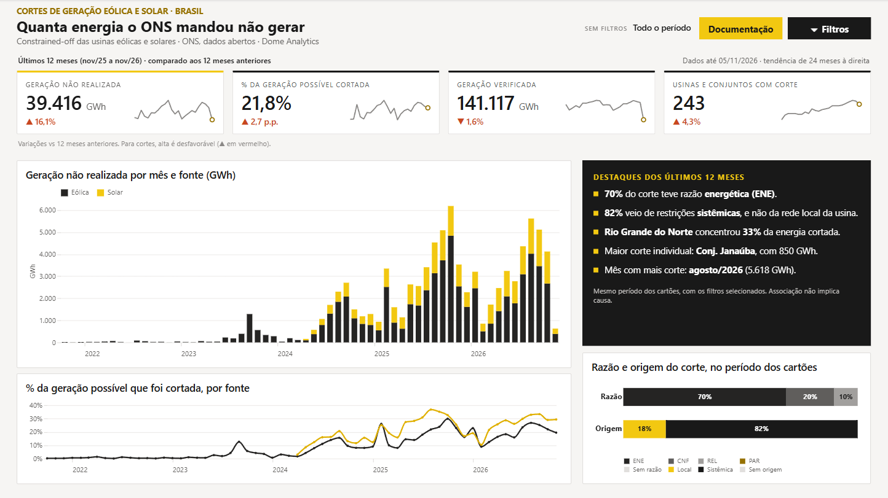

# Cortes de geração eólica e solar no Nordeste

Projeto de estudo de engenharia de dados com dados abertos do ONS (Operador Nacional do Sistema
Elétrico). Desde 2023 o ONS limita a geração de usinas eólicas e solares, principalmente no Nordeste,
por falta de capacidade de transmissão, por segurança da rede ou por falta de consumo. O setor chama
isso de *constrained-off* ou *curtailment*. O projeto mede quanta energia deixou de ser gerada, onde e por qual motivo.

O projeto tem a carga dos dados brutos com Airflow, a modelagem com dbt, a integração contínua no
GitHub Actions e um painel em Power BI.



## Dados

| Fonte | Desde | Granularidade |
|---|---|---|
| [Restrição de operação das usinas eólicas](https://dados.ons.org.br/dataset/restricao_coff_eolica_usi) | out/2021 | usina, 30 min |
| [Restrição de operação das usinas fotovoltaicas](https://dados.ons.org.br/dataset/restricao_coff_fotovoltaica) | abr/2024 | usina, 30 min |

Licença CC BY 4.0. O ONS publica um arquivo Parquet por mês e atualiza o mês corrente por volta das
12h e das 19h. Meses anteriores também são regravados: o arquivo de outubro de 2026 mudou em 5 de novembro.

Os arquivos trazem as usinas de todo o país. O subsistema Nordeste concentra 85% da geração não
realizada até 5 de novembro de 2026, e por isso dá nome ao projeto, mas o painel e os modelos cobrem
também Sudeste/Centro-Oeste, Sul e Norte.

## Como a carga funciona

Cada fonte tem um DAG no Airflow (`ons_restricao_eolica` e `ons_restricao_solar`) que roda às 12h30
e às 19h30. A execução confere o mês corrente e os dois anteriores e compara o ETag de cada arquivo
no S3 com o da última carga, guardado em `raw._cargas`. Quando o ETag muda, baixa o arquivo e troca
as linhas daquele mês numa transação. Rodar a mesma execução duas vezes deixa o banco igual.

Parâmetros ao disparar à mão:

- `desde`: carga histórica a partir de um mês, por exemplo `2021-10`
- `meses_atras`: quantos meses antes do atual conferir (padrão 2)
- `forcar`: baixa de novo mesmo sem mudança no ETag

Se o ONS acrescentar uma coluna, a carga cria a coluna na tabela `raw` antes de inserir.

## Modelagem com dbt

O DAG `dbt_cortes` não tem horário. Ele roda quando uma das cargas termina, porque cada DAG de carga
atualiza um Asset do Airflow que representa a sua tabela no `raw`. Primeiro confere se as fontes
estão em dia (`dbt source freshness`) e depois roda `dbt build`.

| Camada | Modelo | O que tem |
|---|---|---|
| staging | `stg_ons__restricao_eolica`, `stg_ons__restricao_solar` | nomes claros e energia em MWh (o ONS publica MW médios de cada meia hora) |
| intermediate | `int_restricao_semihoraria` | as duas fontes juntas |
| intermediate | `int_usina_cadastro` | atributos mais recentes de cada usina |
| snapshot | `snap_usina` | histórico do cadastro (nome, agente operador, ponto de conexão) |
| marts | `fct_restricao_usina_dia` | geração e geração não realizada por usina e dia, separada por razão e por origem (local ou sistêmica) |
| marts | `fct_restricao_perfil_horario` | geração e geração não realizada por mês, fonte, estado e patamar de 30 minutos, sem a usina |
| marts | `dim_usina` | cadastro atual, a partir do snapshot, com um rótulo de exibição que não se repete |
| marts | `dim_data` | calendário do painel, um dia por linha, do primeiro ao último mês da fato |

A fato é incremental em lotes mensais (`microbatch`) e refaz o mês corrente e os dois anteriores, a
mesma janela que a carga confere. O adaptador do Postgres faz o microbatch com `merge` pela chave, e
assim uma usina que o ONS retirasse de um mês revisado continuaria na fato. A macro
`macros/microbatch_postgres.sql` troca isso por apagar a janela do lote e inserir de novo.

Testes:

- chave única por usina e instante na staging e por usina e dia na fato (teste genérico próprio, `combinacao_unica`)
- valores aceitos para razão (ENE, CNF, REL, PAR) e origem (LOC, SIS) da restrição
- geração não realizada nunca negativa
- minutos de restrição entre 0 e 30, só como aviso, porque o ONS publica alguns valores fora disso
- a soma mensal da fato bate com a da staging, e as razões somam o total de cada dia
- um teste unitário da staging (conversão para MWh, nulos e o traço no CEG)

Para rodar o dbt à mão, fora do Airflow:

```bash
docker compose run --rm dbt build
```

## Painel em Power BI

O painel fica em `powerbi/`, no formato de projeto do Power BI (PBIP). O modelo semântico está em
TMDL e o relatório em PBIR, arquivos de texto que dá para revisar no Git como o resto do código. O
modelo importa quatro tabelas da camada marts (`fct_restricao_usina_dia`, `fct_restricao_perfil_horario`,
`dim_usina` e `dim_data`) e monta duas dimensões compartilhadas a partir do cadastro, Fontes e Estados,
que filtram a fato diária e o perfil horário ao mesmo tempo.

O relatório segue a identidade visual da Dome Analytics (tema em
`StaticResources/RegisteredResources/DomeAnalytics.json`) e tem cinco páginas:

| Página | O que responde |
|---|---|
| Visão executiva | Quanto foi cortado no período e como isso mudou: cartões com variação contra o mesmo intervalo do ano anterior e tendência de 24 meses, corte mensal por fonte, % cortado, razão e origem do corte e destaques escritos por medida |
| Razões e sazonalidade | Por que e quando: participação das razões mês a mês, quadro mês × ano, perfil por hora do dia e calendário dos últimos 365 dias |
| Rede e território | Onde: % cortado por estado, Pareto dos pontos de conexão, concentração do corte e subsistemas |
| Usinas e agentes | Quem: ranking das usinas com tendência, porte × % cortado e agentes operadores |
| Detalhe da usina | Ficha de uma usina escolhida no filtro, com série mensal, razão e origem e calendário |

Sem filtro de ano, os gráficos mostram todo o histórico. Os cartões, os destaques e a barra de razão
e origem da Visão executiva mostram os últimos 12 meses até o último dia com dados, e os calendários
dia a dia mostram sempre 365 dias. Com um ano escolhido, tudo passa a mostrar esse ano, e os cartões
o comparam ao mesmo intervalo do ano anterior, cortado na mesma data para não comparar mês incompleto
com mês cheio. Cada página tem o botão Documentação, um tour que
destaca os visuais um a um e explica o que mostram, como ler, a lógica e as medidas.

Os filtros ficam numa gaveta: o botão Filtros, no canto superior direito, abre um painel com Ano,
Fonte e UF (sincronizados entre as páginas), e o cabeçalho mostra o resumo do que está filtrando. Os
gráficos também filtram a página ao clique: as barras mensais, os estados, os pontos de conexão, os
subsistemas, as usinas do ranking e da dispersão e os agentes. Ctrl+clique soma pontos; clicar num
espaço vazio limpa.

No cadastro do ONS, 14 nomes valem para 32 usinas. Metade desses nomes são parques híbridos, com uma
eólica e uma solar; os outros são conjuntos homônimos da mesma fonte. Para não juntar usinas
diferentes, o painel usa o rótulo do `dim_usina`, que acrescenta ao nome a fonte e, quando ainda
repete, o código da usina.

Ao passar o mouse sobre um mês, um estado ou uma usina, abre uma dica de ferramenta detalhada
(páginas ocultas `dica_mes`, `dica_estado` e `dica_usina`): valor, % cortado, comparação com o ano
anterior, posição no conjunto, razões do corte e o maior contribuinte. Os visuais de dados têm texto
alternativo para leitores de tela, e a ordem de tabulação segue a leitura da página.

Os gráficos personalizados usam os visuais Deneb e HTML Content, que precisam estar instalados no
Power BI Desktop (AppSource). O relatório é gerado por scripts que editam os arquivos PBIR.
Rode com o Power BI Desktop fechado, nesta ordem:

```bash
python scripts/remodelar_painel.py powerbi
python scripts/remodelar_paginas.py powerbi
python scripts/gerar_dicas.py powerbi
python scripts/gerar_tour_documentacao.py powerbi/CortesNordeste.Report/definition
python scripts/gerar_gaveta_filtros.py powerbi
python scripts/interatividade_pbir.py powerbi/CortesNordeste.Report/definition visao_geral/hero_barras razoes_sazonalidade/participacao razoes_sazonalidade/heatmap estados_usinas/uf estados_usinas/pareto estados_usinas/subsistema usinas_agentes/dispersao usinas_agentes/agentes detalhe_usina/mensal
python scripts/acessibilidade_pbir.py powerbi/CortesNordeste.Report/definition scripts/acessibilidade_textos.json
python scripts/validar_pbip.py powerbi
```

O último confere a estrutura (páginas, campos ligados ao modelo, dicas, botões, visuais
personalizados) antes de reabrir o arquivo.

Para abrir, com os containers no ar:

1. Abra `powerbi/CortesNordeste.pbip` no Power BI Desktop (testado na versão de outubro de 2025).
2. Clique em Atualizar e informe o usuário e a senha do Postgres que estão no `.env`.

Os dados importados ficam em `powerbi/*/.pbi/cache.abf`, fora do Git, e por isso o painel abre
vazio até a primeira atualização. O servidor e o banco são parâmetros do modelo (`Servidor` e
`Banco`, em Transformar dados) e apontam para `localhost:5433` e `dw`.

## Integração contínua

O workflow `.github/workflows/ci.yml` roda a cada push na `main` e em cada pull request, com três jobs:

- Lint do SQL: `sqlfluff lint` nos modelos e testes do dbt, com a configuração do `.sqlfluff`.
- DAGs e carga: instala o Airflow 3.3.2 com o arquivo oficial de restrições de versão e roda o
  `pytest`. Os testes conferem se os DAGs importam sem erro, se as cargas avisam o DAG do dbt e se a
  janela de meses da carga está certa.
- dbt build na amostra: sobe um Postgres descartável, carrega `ci/amostra/` no `raw` com a mesma
  função que a carga do Airflow usa e roda `dbt build` duas vezes, a segunda já incremental.

A amostra tem três dias de outubro de 2026 de 15 usinas, escolhidas para cobrir as três razões de
restrição, usinas sem restrição e uma com código CEG. Ela é gerada por `scripts/gerar_amostra.py`
a partir dos arquivos que a carga baixou.

Para rodar as mesmas verificações na máquina, fora do Docker:

```bash
python -m venv .venv
.venv/Scripts/pip install -r requirements-ci.txt
.venv/Scripts/sqlfluff lint dbt/models dbt/tests
.venv/Scripts/python -m pytest tests
```

No Windows o teste dos DAGs é pulado, porque o Airflow não roda direto no Windows. Ele roda dentro
da imagem do projeto ou no CI.

## Como rodar

Precisa do Docker com Docker Compose e do Python 3 (só para gerar o `.env`). A imagem do Airflow
é montada na primeira subida, com o dbt num ambiente Python separado.

```bash
python scripts/criar_env.py
docker compose up -d
```

O `criar_env.py` sorteia a senha do Postgres e as chaves do Airflow e grava tudo no `.env`, que fica
fora do Git. O Airflow abre em http://localhost:8080, sem login, porque escuta só na própria máquina.
O Postgres atende em `localhost:5433`, banco `dw`, com usuário e senha do `.env`.

Os DAGs começam pausados. Ative os três (as duas cargas e o `dbt_cortes`) e dispare a carga
histórica: a eólica com `{"desde": "2021-10"}` e a solar com `{"desde": "2024-04"}`.

Para parar os containers sem perder os dados:

```bash
docker compose stop
```

## Estrutura

```
dags/ons_restricao.py   DAGs de carga, um por fonte
dags/dbt_cortes.py      DAG do dbt, disparado pelas cargas
dags/ons/carga.py       download, comparação de ETag e carga no Postgres
dags/ons/ativos.py      Assets das tabelas raw
dbt/                    projeto dbt (staging, intermediate, marts, snapshot, testes)
powerbi/                painel em Power BI (PBIP: modelo em TMDL, relatório em PBIR)
docs/                   capturas do painel
ci/amostra/             amostra de dados para o CI
tests/                  testes em Python (DAGs e carga)
scripts/                geração do .env e da amostra, carga da amostra, geração do relatório do painel
.github/workflows/      CI
Dockerfile              imagem do Airflow com o dbt
docker-compose.yml      Airflow 3 (LocalExecutor), Postgres 17 e o dbt para uso à mão
postgres/init.sql       cria os bancos airflow e dw
```

## Licença

Código sob licença MIT. Dados do ONS sob CC BY 4.0.
